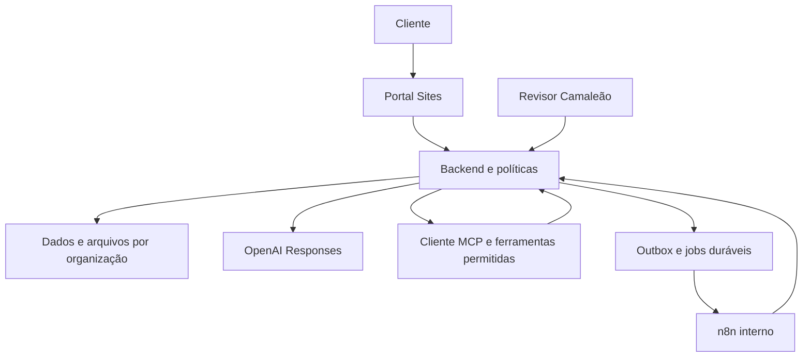

# Camaleão Infra Portal — plano mestre

Data: 11/10/2026 · Responsável de produto: Carlos Felipe / Agência Camaleão.

## 1. Decisão executiva

Criar uma linha de serviços da Agência Camaleão apoiada por um portal: **diagnóstico → plano revisado → implantação contratada → operação acompanhada**. O cliente descreve o resultado desejado e recebe uma recomendação proporcional ao que já tem. A Camaleão assume a revisão e a entrega técnica dentro de um escopo contratado.

Nome de trabalho: **Camaleão Infra Portal**. Mensagem proposta: **“Sua empresa pronta para usar IA, com um plano claro e acompanhamento da Camaleão.”** Ambos são propostas, não marcas registradas ou ofertas já publicadas.

A primeira versão deve atender empresas de serviços profissionais com um processo repetitivo identificado. Prioridade sugerida: escritórios e consultorias que precisam consultar documentos internos ou organizar atendimento e tarefas. Mercado, disposição de pagar e capacidade de entrega ainda precisam de validação.

## 2. O que sabemos e o que falta

| Elemento | Estado observado nesta entrega |
| --- | --- |
| Marca e domínio | Agência Camaleão e https://camaleaoweb3.com.br/ indicados pelo usuário |
| Site atual | Abertura direta retornou erro/HTTP 403; conteúdo oficial indexado foi recuperado. A home apresenta IA/agentes/automação, IA soberana e modelo de diagnóstico→validação→implementação. Assets e operação não foram auditados |
| Stack relatada | VPS Hostinger, n8n, Supabase, GitHub, OpenAI API e Sites; capacidade e configuração de produção não auditadas |
| GitHub pessoal | Login `ofelipepeixoto` confirmado pelo conector |
| Competência técnica | Especialidades Infra Master usadas para estruturar módulos e controles do produto |
| APIs e contas do portal | Ainda não configuradas; conexão neste chat não concede acesso ao aplicativo futuro |
| Entrega atual | Plano, contratos, demonstração local e referência offline; sem lançamento do portal ou processamento pago |

A demonstração usa identificação textual Camaleão e uma direção visual provisória escura/verde. Aplicar logo oficial e tokens visuais após confirmar os assets. O site principal permanece um canal de apresentação; seu projeto e sua hospedagem não precisam ser alterados para planejar o portal.

## 3. Melhorias sobre a ideia original

1. Vender um resultado definido: plano aplicável e implementação verificável, com supervisão técnica.
2. Separar cliente leigo e operador técnico. O cliente vê escolhas simples; a equipe vê arquitetura, custos, licenças, testes e evidências.
3. Usar formulários guiados com conversa opcional. Reduzir campos livres e tornar a próxima pergunta dependente das respostas anteriores.
4. Reaproveitar o que existe antes de propor uma nova stack.
5. Mostrar dados faltantes e grau de evidência. Um diagnóstico preliminar não vira orçamento fechado automaticamente.
6. Evoluir para catálogo de projetos repetíveis somente depois de medir qualidade e margem.
7. Oferecer processamento externo, híbrido ou privado segundo a política do cliente; avaliar toda a cadeia para qualquer alegação de soberania.

## 4. Jornada do cliente

| Etapa | Experiência simples | Resultado |
| --- | --- | --- |
| Entrada | “O que você quer melhorar?”: documentos, atendimento, tarefas ou avaliação técnica | Objetivo e encaminhamento |
| Contexto | Escolher porte, ferramentas já usadas, sensibilidade e política de dados; “não sei” disponível | Inventário preliminar |
| Pré-diagnóstico | Uma recomendação, alternativa, lacunas e próximos passos | Hipótese clara para revisão |
| Validação | Consultor confirma contexto, acesso e expectativa; cliente corrige resumo | Diagnóstico versionado |
| Proposta | Escopo, entregas, exclusões, custos e responsabilidades | Proposta comercial revisada |
| Projeto | Etapas, responsáveis, arquivos autorizados e pedidos de aprovação | Implantação rastreável |
| Operação | Consumo, chamados, saúde do serviço e relatórios de mudanças | Continuidade contratada |

Não solicitar senha, token, chave privada ou acesso root no formulário/conversa. O onboarding técnico usa mecanismo protegido separado. Nunca interpretar “aprovo o diagnóstico” como autorização para contratar infraestrutura ou executar mudanças.

## 5. Duas interfaces

**Portal do cliente:** minhas necessidades, meus diagnósticos, propostas, cronograma, documentos, consumo, suporte e histórico de aprovações.

**Console da Camaleão:** fila de triagem, validação de inventário, comparação de soluções, revisão de respostas, propostas versionadas, execução por runbook, auditoria, custos e carteira de clientes. Papéis distintos: comercial, especialista, operador, revisor e administrador. Acesso técnico deve respeitar escopo de projeto e registro de justificativa.

## 6. MVP recomendado

Um piloto concierge com 3 empresas e uma oferta principal: diagnóstico + plano de um assistente documental ou automação simples, seguido de implantação somente após contrato. “3” é tamanho proposto para o experimento, não clientes já adquiridos.

Inclui: triagem guiada, cadastro organizacional, diagnóstico preliminar, revisão humana, relatório com evidências, proposta, quadro de projeto, limite de consumo e console interno. Documentos reais entram apenas depois do gate de identidade, política de dados e permissões.

Fases seguintes: base documental com RAG, conectores consentidos por cliente, WhatsApp oficial, relatórios operacionais e catálogo de templates homologados. Provisionamento autônomo, marketplace, GPU e infraestrutura física dependem de demanda medida e capacidade operacional.

## 7. Papel de cada componente

| Componente | Papel no produto | Primeira adoção |
| --- | --- | --- |
| Sites do ChatGPT | Interface e camada web leve; identidade nativa conforme recursos reais da conta | Protótipo e piloto controlado |
| OpenAI Responses API | Interpretar linguagem, formular perguntas e redigir diagnóstico estruturado | Depois de chave segura, modelo avaliado e teto de gasto |
| Backend próprio | Autorizar, validar, persistir, controlar custo e aprovações | Antes de dados reais |
| MCP próprio | Expor ferramentas estreitas de consulta e preparação ao assistente | Começar pelo laboratório local; remoto após autenticação |
| n8n | Orquestrar rotinas internas, callbacks e notificações | Workflows definidos e operados pela equipe |
| PostgreSQL/Supabase | Organizações, membros, projetos, versões, eventos e storage autorizado | Ambiente separado e homologado |
| VPS Hostinger | Backend Python, jobs e serviços persistentes em containers isolados | Após inventário de capacidade e recuperação |
| GitHub | Fonte, documentação, testes, revisão e releases | Este repositório |
| Meta/WhatsApp | Canal opcional de entrada e notificações consentidas | Fase 2 |

O protocolo MCP não substitui o backend, a fila ou a autorização. Plugins do ChatGPT contribuem com instruções e ferramentas desta sessão. No produto, as instruções precisam ser adaptadas e versionadas; cada integração exige implementação, credencial própria, consentimento, termos e teste. Não reutilizar a conta pessoal do operador para dar a todos os clientes acesso a recursos privados.

## 8. Arquitetura alvo

Rota inicial preferida: backend controla um cliente MCP local para ferramentas próprias e converte resultados de ferramentas em contexto da chamada OpenAI. A variante de MCP remoto direto pela Responses API fica condicionada à autorização do servidor, compatibilidade e análise de egress. A referência stdio não é um endpoint remoto compatível para cadastro direto na API.

## 9. Sites e domínio

Domínio proposto: `infra.camaleaoweb3.com.br`; disponibilidade, DNS, contrato e suporte a domínio ainda não verificados. Manter o código portátil no GitHub.

Sites fornece identidade nativa para visitantes autenticados. Sign-in estabelece identidade, não vínculo com uma empresa; o backend deve consultar membresia e autorização. No piloto, confirmar suporte da conta a visitantes externos e a experiência de login antes de usar dados de clientes. Usar os helpers nativos do Sites; não montar um segundo OAuth no Site.

Um BFF (camada web do servidor) verifica a identidade Sites e encaminha ao backend uma credencial interna de curta duração com `issuer`, `audience`, `subject`, organização resolvida, papéis e expiração. O backend verifica assinatura e claims. Headers de identidade recebidos diretamente da internet não são fonte confiável. Nenhuma chave privilegiada deve chegar ao navegador.

Se o login nativo criar fricção incompatível com o público ou o plano impedir o piloto, validar hospedagem do mesmo frontend na VPS com autenticação própria suportada. Isso é alternativa de implantação, sem supor autenticação externa disponível no Sites. A triagem pública anônima deve ser limitada, sem documentos sensíveis e sem operações pagas ilimitadas.

O runtime Sites é Worker com conexões HTTP; backend de documentos, OCR e jobs ficam fora do frontend. Ler instruções atuais da plataforma antes de criar o Site. Esta entrega é preparação para o futuro: nenhum Site foi registrado ou publicado.

## 10. Conhecimento e comportamento do assistente

Adaptar a especialidade Infra Master em módulos Camaleão com objetivo, entradas, fontes, saídas, versão e testes. Selecionar somente módulos pertinentes a cada demanda. Um assistente principal basta para o MVP; revisão técnica e segurança são etapas do processo, sem multiplicar runtimes por especialidade.

RAG inicial sobre catálogo e playbooks da Camaleão com revisão editorial. Conhecimento do cliente só após permissão por documento, ingestão rastreável, hash/versão, citações e teste de recuperação. Separar fontes comerciais, orçamento de fornecedor e evidência técnica. Materiais enviados não comprovam instalação, preço, SLA ou certificação.

## 11. OpenAI

Usar Responses API com `text.format`/JSON Schema para diagnósticos estruturados e function calling quando o modelo precisar solicitar ferramentas. Modelo é configuração; selecionar uma versão disponível por avaliação de português, qualidade, latência, custo e políticas. Não fixar escolha só pela popularidade.

Chaves no backend, por projeto; orçamento por organização e global; limite de contexto, saída, chamadas e tentativas. Validar recusa, status incompleto, schema e invariantes no backend antes de publicar diagnóstico. `store:false` reduz estado de aplicação, mas não ativa Zero Data Retention nem elimina todas as formas de retenção. Verificar ferramentas, cache e terceiros na política do cliente.

Os conectores e skills OpenAI Developers selecionados devem ser usados para documentação e provisionamento seguro quando disponíveis. Nesta sessão não há uma chave do portal configurada ou uma chamada paga validada. Contratos de requisição são exemplos offline.

## 12. MCP e autonomia

Ferramentas iniciais: consultar catálogo, validar intake e preparar diagnóstico. Posteriormente: consultar projeto e uso, buscar documentos autorizados, preparar proposta e abrir pedido de execução.

O assistente não possui ferramenta de shell, criação de VPS, edição livre de banco ou assinatura de transações. Pedidos de execução tornam-se objetos imutáveis aprovados por responsáveis. Credenciais, organização e papel são resolvidos no servidor, nunca pelo argumento indicado pelo modelo.

Remoto: Streamable HTTP, TLS, autenticação e OAuth/resource audience conforme especificação atual, scopes mínimos, rate limit, timeout e auditoria. Aprovação de compartilhamento de dados no MCP e aprovação de uma ação de negócio são controles diferentes.

## 13. n8n

Fluxos planejados: triagem para fila de consultor; preparação de diagnóstico; revisão para publicação; proposta aceita para abertura de projeto; monitoramento contratual; notification outbox. O backend autoriza e gera eventos; n8n executa ações fixas, registra resultado e retorna por callback assinado.

Use `event_id`, schema version, assinatura, replay window, idempotência persistida, retries limitados e reconciliação de resultado desconhecido. O histórico minimiza dados sensíveis. Editor e lógica de workflows permanecem sob operação da Camaleão no MVP. Revalidar licença do uso concreto; criação/edição de workflows pelo cliente via API/MCP/IA muda a análise mesmo com editor oculto.

## 14. Dados e isolamento

Entidades: organizações, membros, intakes, diagnósticos e versões, propostas, aprovações, projetos, documentos/ACLs, jobs, conexões, consumo, reservas de orçamento, auditoria e outbox. Todas as relações entre recursos e organização precisam ser verificadas; permissões de documento sobrevivem à indexação.

Banco com papéis técnicos mínimos e políticas; storage privado com autorização antes de URL temporária; filtros no vetor, memória, filas, cache e exportação. Backups exigem retenção e restauração por cliente. RLS é um componente do controle, não prova suficiente. Credenciais administrativas no backend, com uso operacional restrito.

## 15. Soberania e oferta

Diagnosticar dependências de inferência, embeddings, OCR, reranking, voz, identidade, logs, backups, CDN, suporte e conectores. Ofertar processamento externo controlado, híbrido ou ambiente privado conforme contrato e evidência. Dados restritos sem autorização adequada bloqueiam envio externo; não fazer fallback silencioso.

API externa com Supabase hospedado não deve ser comercializada como operação inteiramente sob controle do cliente. GPU/LLM local só após benchmark e justificativa de custo. Data center próprio permanece módulo de estudo para demanda enterprise, com revisão profissional da infraestrutura física.

## 16. Monetização e custo

Estrutura proposta: diagnóstico qualificado → implantação por escopo → operação mensal com cota → capacidade adicional mediante aprovação. Receitas ainda não validadas. Não usar preço por token como única explicação comercial.

`custo_entrega = horas × custo_hora + IA + infraestrutura incremental + licenças + suporte + recuperação`

`preço_mínimo = custo_entrega / (1 − tributos_% − comissões_% − margem_alvo_%)`

Só calcular quando denominador positivo e entradas confirmadas. Estimar cenários de baixo uso, uso esperado e estresse. Horas poupadas não são automaticamente economia de caixa.

Limites: reserva atômica antes de cada operação paga; soma de uso efetivo e reservas pendentes por tenant/global; timeout incerto mantém reserva; conciliação libera só o excedente comprovado. Custos abaixo da cota não autorizam operação sem permissão. O protótipo apenas demonstra invariantes em memória, sem enforcement real de um fornecedor.

## 17. Plano 30/60/90

| Horizonte proposto | Entrega | Gate |
| --- | --- | --- |
| 0–30 dias | Descoberta, 10 entrevistas, até 3 empresas convidadas, protótipo, oferta e aceite definidos | Problema repetido, comprador identificado, evidência de disposição de pagar |
| 31–60 dias | Portal autenticado, persistência, revisão humana, 1 integração autorizada e limites de custo | Isolamento A/B, restauração, avaliações reais e custo por resultado aprovado |
| 61–90 dias | Operação assistida, projeto pago, suporte, métricas e primeiro template replicável | Margem de contribuição, aceite, carga de suporte e intenção de renovação demonstrados |

Datas e volumes são hipóteses para gestão. Ajustar segundo equipe, acesso e demanda. Não prometer lançamento em 90 dias sem estimativa técnica após inventário.

## 18. Métricas e decisão

North Star sugerida: projetos que chegam ao resultado aceito pelo cliente dentro do escopo e do orçamento. Acompanhar funil início→conclusão→revisão→proposta→pagamento; tempo até plano validado; taxa de correção do diagnóstico; falhas críticas; custo por resultado aceito; horas humanas por projeto; margem; chamados; uso e renovação.

Não ampliar se houver falha de acesso cruzado, gasto sem reserva, mudança sem autorização ou resposta comercial sem evidência. Se 10 entrevistas não revelarem problema recorrente, rever oferta/segmento; se os pilotos exigirem trabalho totalmente diferente, reduzir catálogo. Os números são critérios propostos de experimento, não estatística de mercado.

## 19. Próxima etapa concreta

Revisar a demonstração e o escopo comercial. Para primeira homologação persistente, definir responsável, organização/ambiente, modalidade de login, dados de teste e teto de custo. Em seguida inventariar VPS/n8n/Supabase por acesso seguro, configurar uma chave de projeto e implantar uma fatia ponta a ponta. Aceite: um cliente autenticado conclui intake, recebe diagnóstico persistido, um revisor aprova uma versão e somente essa versão fica visível ao cliente, com consumo e auditoria rastreáveis.

## 20. Leitura e evidências

- [Arquitetura e contratos](ARQUITETURA-E-CONTRATOS.md)
- [Negócio e jornada](NEGOCIO-E-JORNADA.md)
- [Segurança e homologação](SEGURANCA-E-HOMOLOGACAO.md)
- [WhatsApp oficial](WHATSAPP-OFICIAL.md)
- [Mapa de especialidades](MODULOS.md)
- [Backlog de execução](BACKLOG.md)
- [Fontes oficiais e limites](FONTES-E-LIMITES.md)
- [Verificação realizada](VERIFICACAO.md)

Autoria do projeto: Agência Camaleão / Carlos Felipe. Revisões humanas, contratos e licenças dos componentes permanecem necessários para a implantação comercial.
